<h1 align="center">Tallys Cesar</h1>

  Desenvolvedor mobile &amp; backend · Pau dos Ferros/RN, Brasil

  
  
  
  
  

---

Estudante de **Análise e Desenvolvimento de Sistemas no IFRN** e desenvolvedor focado em **mobile e backend**. Construo apps com **React Native/Expo** e **Swift**, APIs com **Django**, **Node.js** e **Rails**, e também trabalho com **sistemas embarcados** em C e FPGA pela residência EmbarcaTech. Gosto de soluções bem estruturadas, de open source e de compartilhar o que aprendo no YouTube.

### Projetos em destaque

| Projeto | Descrição | Stack |
| --- | --- | --- |
| [**CineClub**](https://github.com/TallysCesarGB/2026-ifrn-ads-dsw-integrador-1) | Rede social para cinéfilos com indicações, avaliações e catálogo da TMDB | Django · Python |
| [**Bug Tracker**](https://github.com/TallysCesarGB/rubyOnRails-bug_tracker) | Gerenciador de bugs com API e SPA | Rails · React |
| [**Memory Game**](https://github.com/TallysCesarGB/microservices_memory_game) | Jogo da memória com temas dinâmicos e níveis progressivos | React Native · Expo |
| [**Mouse Gear**](https://github.com/TallysCesarGB/swift-mouse-gear-tsp) | Simulação 3D com física que resolve o Problema do Caixeiro Viajante | Swift · SceneKit |
| [**Caçador Estelar**](https://github.com/TallysCesarGB/learning-a-star) | Comparação em tempo real entre Busca Gulosa e A\* em 3D | Swift · SwiftUI |
| [**Telemetria LoRa**](https://github.com/TallysCesarGB/fpgaWithLoRa) | Transmissão de dados ambientais via LoRa entre FPGA e BitDogLab | C · FPGA · SoC |

### Stack

  

### Estatísticas

  
  

  

  

  <picture>
    <source media="(prefers-color-scheme: dark)" srcset="https://raw.githubusercontent.com/TallysCesarGB/tallyscesargb/pacman-output/pacman-contribution-graph-dark.svg">
    
  </picture>

