  

  

  <h1>Tallys Cesar Gurgel Batista 👨🏻‍💻</h1>

  

   

  
  

 
  
  
   
  
   

## 🤖 Linguagens e Tecnologias

  
  
  
  
  
  
  
  
  
  
  
  
  
  
  
  
  
  
  
  
  
  
  
  
  
  
  
  
  
  
  
  
  
  
  
  
  
  
  

## 🏆 Troféus

  

## 📊 Estatísticas

  
  
   
  

## 🎮 Contribuições

  <picture>
    <source media="(prefers-color-scheme: dark)" srcset="https://raw.githubusercontent.com/TallysCesarGB/tallyscesargb/pacman-output/pacman-contribution-graph-dark.svg">
    <source media="(prefers-color-scheme: light)" srcset="https://raw.githubusercontent.com/TallysCesarGB/tallyscesargb/pacman-output/pacman-contribution-graph.svg">
    
  </picture>

  <picture>
    <source media="(prefers-color-scheme: dark)" srcset="https://raw.githubusercontent.com/TallysCesarGB/tallyscesargb/output/snake-dark.svg">
    <source media="(prefers-color-scheme: light)" srcset="https://raw.githubusercontent.com/TallysCesarGB/tallyscesargb/output/snake.svg">
    
  </picture>

  

